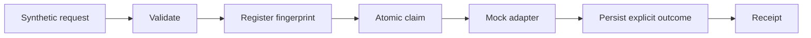

# Enquiry workflow · Love Yours Media

A small, inspectable demonstration of a reliable enquiry-processing boundary. It uses **synthetic data and a mock delivery adapter**; it sends nothing.

## What it proves

- Durable SQLite idempotency: the same identifier and payload is processed once; a conflicting payload is rejected.
- Atomic claiming under concurrent requests.
- Explicit delivery outcomes: delivered, permanently rejected, safely retryable or uncertain.
- Only known pre-transmission failures can be retried, with a three-attempt cap. Ambiguous outcomes are quarantined, not resent.
- Stale in-flight work becomes uncertain after restart. Payloads and raw exception details are omitted from application logs and validation errors.

## Run

Requires Python 3.12 or later. From this repository:

```sh
python3 -m venv .venv
. .venv/bin/activate
pip install -r requirements-dev.lock
pip install --no-deps -e .
python examples/walkthrough.py
pytest -q
ruff check .
mypy enquiry_workflow
uvicorn enquiry_workflow.api:create_app --factory --host 127.0.0.1 --port 9403
```

Open http://127.0.0.1:9403/docs. Submit only the model's synthetic fields; it intentionally has no email/name/free-text fields. The `delivery_mode` selects a mock scenario, not a production delivery option. Runtime SQLite files stay in the ignored `runtime/` directory.

## Architecture



The database transaction ends before delivery. A crash between delivery and persistence cannot be made exactly-once by this local database; it is deliberately classified as uncertain. A real transport would need a remote idempotency contract and reconciliation. Duplicate POSTs do not retry; the explicit retry route only acts on safely retryable records. Pending records are not automatically drained by a worker.

## Validation and limits

17 tests cover duplicate requests, conflicting payloads, restart durability, concurrency, retry limits, rejection, ambiguity, redaction and API validation. Ruff and strict mypy pass. A dated dependency audit is in `docs/QA.md`.

This unauthenticated local API is not an internet service. Production delivery would require authentication, authorisation, rate limits, encrypted transport, retention rules, operational monitoring and a tested real adapter. No client data or private operational code is included.

MIT licensed; see `LICENSE`.
